<div align="center">

# Ken Research Agentic Interlinking OS

**A governed, self-hosted system that discovers, reviews, publishes, verifies and learns from contextual internal links across Ken Research content.**


</div>

## Executive summary

Ken Research has thousands of reports, articles, surveys and commercial service pages. This project turns that catalogue into a connected research journey.

The system:

1. reads and versions website content;
2. understands each page's market, geography, industry, type and intent;
3. finds genuinely related source and destination pages;
4. applies hard relevance, geography, eligibility and safety gates;
5. drafts a natural contextual link and explains why a reader may use it;
6. shows the exact source evidence, destination evidence, anchor and placement to a reviewer;
7. records approval, revision or rejection and the reason;
8. publishes only an explicitly authorised, version-locked change through the CMS API;
9. verifies the link in both CMS data and the public rendered page;
10. keeps a rollback handle and learns from decisions and outcomes.

The business objective is not to maximise link count. It is to help visitors discover the next useful piece of research, reduce orphan and dead-end pages, strengthen coherent topic clusters, and create relevant journeys toward reports, samples, analysts, surveys, experts and consulting services.

> **Current safety boundary:** the latest writes are controlled canaries on `thekenconsulting.com`, a test host that declares `noindex,nofollow`. They prove drafting, approval, CMS mutation, public rendering and rollback. They do **not** transfer SEO authority and are not a claim of production impact on `kenresearch.com`.

## How this project helps build contextual interlinking

Interlinking by hand does not scale, and keyword matching produces links that mislead readers. The
system divides the work: software does the searching, checking and publishing mechanics, and people
make every editorial decision.

| Stage | What the system does | Measured evidence |
|---|---|---|
| Find | Compares each report with every plausible destination by meaning, wording, taxonomy, geography and position in the link graph | 9 Nov 2026 run over the 8,858-page sitemap inventory: 706,907 candidate pairs evaluated in 1 h 37 min, 0 errors |
| Filter | Deterministic gates refuse the links a careful editor would refuse, before anyone spends time on them | Same run: 245,149 refused as unrelated markets, 190,054 as the wrong geography, 166,535 as incompatible page types and 99,604 for lack of a natural anchor; 915 link plans survived |
| Write | Links words already on the page where possible; otherwise adds a bridge sentence that must cite source and destination evidence and pass the copy rule | The 18 bridge sentences in the Kuwait topic and exact-market batches each carry a figure taken from the destination report |
| Decide | Shows the reviewer the exact before/after copy, evidence, seven KPI scores and the hard gates, and stores every decision with its reason | 31 proposals decided in the review dashboard: 28 approved, 3 rejected with a structured reason |
| Publish | Dry run, exact version lock, atomic apply, CMS read-back, public-page check and a rollback handle for every change | 25 links live on the test host, all confirmed present on the public pages on 25 Nov 2026; 4 changes that saved but never displayed (deployments 20, 26, 27, 29) were caught and rolled back, and 2 links placed before a later editorial rule were removed on the owner's instruction |
| Learn | Turns decisions and incidents into evaluation data and enforced rules | Owner feedback on formulaic copy became a validator that now blocks such copy before any write |

The outcome is fewer, better links: each has a recorded reason, evidence at both ends, a named
approver and an undo.

## What has been built

| Capability | What it does | Current state |
|---|---|---|
| Content inventory | Imports exports or crawls public pages; normalises URLs; stores immutable page versions, canonical data and existing links | Implemented |
| Content intelligence | Classifies page type, market, industry, geography and intent; creates embeddings and typed relationships | Implemented |
| Hybrid discovery | Uses semantic, lexical, taxonomy, geography, graph and under-linking signals | Implemented |
| Recommendation engine | Applies deterministic gates, scoring, anchor selection and placement rules; creates explainable link plans | Implemented |
| Contextual copy | Links existing text, makes a supported micro-edit, or adds a short evidence-backed bridge sentence | Piloted and live-tested: each proposal drafted case by case in `tools/v02-contextual-audit`. Automated drafting inside the engine is not built yet (ADR-0023) |
| Human review | Shows before/after copy, evidence, seven KPI scores and hard gates; captures approve/revise/reject feedback | Implemented |
| Controlled CMS publishing | Dry run, exact version lock, idempotent operation ID, atomic apply, verification and rollback | Implemented and live-tested |
| Related-market and regional clusters | Evaluates exact-market regional siblings and closely connected workflow/topic pages without forcing reciprocity | Implemented in review and canary workflows |
| Graph intelligence | PageRank, hub and authority scores, crawl depth, orphans and bridges, computed into PostgreSQL | Implemented |
| Graph audits | Snapshot, before/after diff, shortest path and sitemap-seed discovery | Prototype tool (`tools/graph-intelligence`) over the 28-report Kuwait snapshot; not yet wired into the inventory or graph services |
| Rendered-visibility controls | Maps which report paragraphs the public template actually shows; confirms every published link on the public page | Implemented in the pilot toolchain |
| Copy rule | Refuses bridge copy that breaks the owner's rule before any CMS request, and flags it on every dashboard card | Implemented in the pilot toolchain |
| Priority routing | Holds governed, time-bound business-priority designations behind every relevance and safety gate | Implemented in shadow mode |
| Analytics and learning | First-party link events, optional GA4/GSC inputs, decision logs, evaluation datasets and policy/skill proposals | Implemented; real outcome volume is still limited |
| Selective autonomy | Supports shadow, guarded and autonomous policy modes; production promotion remains human controlled | Implemented; default is shadow |

## Contextual interlinking, in plain language

This is the key capability currently being piloted.

Keyword overlap alone is not enough. A good contextual link must make sense inside the sentence, preserve the source report's meaning, and tell the visitor what additional information the destination provides.

### The reader test

A proposal is eligible only when the surrounding copy answers both questions:

1. Why is this destination related to the point I am reading?
2. What useful information will I receive if I click?

If either answer is unclear, the system creates no inline link.

### The four permitted outcomes

1. **Link useful text that already exists.** This is the lowest-risk option.
2. **Make a small contextual edit.** Add only a supported market term or qualifier without changing the claim.
3. **Add a short bridge sentence.** Explain the operational or research connection using evidence from the source and destination.
4. **Create no link.** A missing link is better than a forced, misleading or promotional link.

### Example implemented on the test host

Source topic: Kuwait cloud-based retail inventory forecasting.

Destination topic: Kuwait cloud-based order management systems.

Published contextual copy:

> For execution, **order management systems** help turn inventory forecasts into stock reservations and fulfilment plans. The Kuwait market is projected to reach USD 137 Mn by 2032.

Why this works:

- the source already discusses forecast-led inventory decisions;
- order management is the next operational step in that workflow;
- the anchor accurately predicts the destination;
- one publicly visible destination figure gives the visitor a useful preview;
- the wording remains neutral and useful even without the hyperlink;
- the original source facts and meaning are preserved.

### Placement rules learned from real rendering

Preferred surfaces are visible explanatory prose in:

- Market Trajectory;
- Growth Drivers or Opportunities, but only when that content visibly renders;
- segmentation explanation;
- regional analysis, but only when that content visibly renders.

Hard exclusions:

- **Market Overview:** it must remain focused on the report's own market;
- **Related Reports:** it already performs the recommendation job, so an inline link there is duplicative and pushy;
- headings, tables, navigation, table of contents, citations, methodology, legal copy, hidden descriptions and boilerplate FAQs.

Live testing exposed an important template issue: the public page shows only part of what the CMS holds. Mapping three reports paragraph by paragraph (`tools/v02-contextual-audit/map-rendered-sections.mjs`) found Market Trajectory and Key Stakeholders fully shown, Growth Drivers showing 1 of its 10 paragraphs, and Research Methodology and FAQ not shown at all. Visibility is decided paragraph by paragraph, not section by section: links in Market Segmentation, Regional Analysis and Growth Drivers are live where their exact paragraph is one of the visible ones.

A CMS success is therefore never treated as proof. Every applied link must also be found as a visible, crawlable `<a href>` in rendered HTML, and non-rendering placements are rolled back.

### Copy controls

- Preserve existing numbers, dates, entities, comparisons and market claims.
- Every added claim must be traceable to stored source or destination evidence.
- Use neutral analyst language, normal punctuation and no sales pressure.
- Do not use “click here”, curiosity bait or unsupported cause-and-effect wording.
- Avoid em dashes and repetitive AI-style phrasing.
- Use no more than one new inline link per content block.
- Inserted bridge copy is governed separately from the internal rationale and cannot simply publish the rationale as page text.
- Current bridge-copy rule (owner, 20 Nov 2026): at least two sentences, 32–38 words in total, no dashes, currency figures to at most one decimal, and no direct address to the visitor. `tools/v02-contextual-audit/copy-rules.mjs` enforces it before any CMS request.

Detailed editorial rules: [Full contextual interlinking](knowledge/FULL_CONTEXTUAL_INTERLINKING.md) and [optimisation lessons](knowledge/INTERLINKING_OPTIMISATION_LESSONS.md).

## Reviewer dashboard and scoring

The local v0.2 review dashboard runs at `http://127.0.0.1:4177`:

```powershell
npm run dashboard:v02
```

Each proposal shows:

- source and destination pages;
- current source copy and proposed linked copy;
- exact anchor and placement section;
- source and destination evidence;
- reader benefit and relationship rationale;
- current CMS version and validation state;
- indexability, canonical and rendered-link gates;
- approval history, structured rejection reason and reviewer notes;
- live deployment status after publishing;
- a filterable topic graph with existing, proposed and live edges.

The editorial reference score is out of 100:

| KPI | Weight | What the reviewer checks |
|---|---:|---|
| Reader need | 15 | The source creates a genuine question, task or useful next step |
| Source evidence | 15 | The exact source passage establishes that need |
| Destination fit | 20 | Destination evidence answers or materially advances it |
| Anchor expectation | 15 | The anchor accurately predicts the page that opens |
| Context and placement | 15 | The link reads naturally in an approved visible section |
| Added information value | 10 | The destination adds information instead of repeating the source |
| Quality and risk | 10 | The wording is supported, neutral, non-redundant and non-promotional |

Reference outcomes are 85–100 **approve**, 70–84 **revise**, and 0–69 **reject**. Missing evidence produces **insufficient evidence**, regardless of the numeric total.

This is an editorial aid, not a Google score, ranking prediction or LLM-citation score. A high score cannot bypass hard gates.

## Hard gates before a link can go live

```text
Candidate
  -> source and destination eligible
  -> page families compatible
  -> market relationship valid
  -> geography relationship valid
  -> source evidence exists
  -> destination evidence exists
  -> approved visible placement
  -> natural, descriptive anchor
  -> no duplicate or over-linking
  -> human decision where required
  -> CMS dry-run validates
  -> source version still matches
  -> atomic apply succeeds
  -> CMS content verifies
  -> public rendered anchor verifies
  -> deployment and rollback recorded
```

Business priority, commercial value and orphan status can reorder candidates only **after** these gates pass. They cannot make an irrelevant link eligible.

## Current canary evidence

The repository contains durable, reproducible audit files for the v0.2 test-host work.

### Live on the test host today

Checked against the public pages on 25 November 2026: all 25 links below are present.

| Batch | Date | Deployments | Live |
|---|---|---|---:|
| First existing-text links | 19 Nov | 21, 22, 24 (18 and 19 rolled back 25 Nov) | 3 |
| v0.2 contextual batch | 19-20 Nov | 28, 30, 31-32, 33-34 | 4 (3 more rolled back) |
| Kuwait topic cluster | 20 Nov | 35-42 | 6 |
| Exact-market regional clusters | 20 Nov | 43-54, copy rewritten as 55-66 | 12 |
| **Total** | | | **25** |

### Waiting for an owner decision

- **Seven drafts ready for approval.** The three rolled-back links are redrafted into visible
  Market Trajectory paragraphs under new IDs (`v02-relocated:1`, `:2`, `:4`), because the old
  approvals covered other wording in another section. Four more (`cluster:1`, `:6`, `:15` and
  `topic-kuwait:7`) are rewritten to the copy rule. All seven pass a CMS dry run and the copy rule;
  none can be published without an approval.

Deployments 18 and 19 had been placed in Market Overview before
[ADR-0031](docs/adr/ADR-0031-editorial-section-and-engagement-gates.md) made that section a hard
exclusion. The system flagged them rather than removing live content on its own; on the owner's
instruction both were rolled back on 25 November 2026. Each link is gone from the CMS and the
public page, and the surrounding text is unchanged
([record](outputs/contextual-v02-live/market-overview-rollback-2026-11-25.json)).

### Kuwait topic cluster

- Seven evidence-backed proposals were drafted and scored from 92 to 97.
- Six owner-approved proposals are CMS-verified and publicly rendered.
- Deployment history: canary revisions `35–37`, approved batch `38–42`.
- The seventh proposal remains unpublished because it was not approved.
- The graph snapshot contains 28 reports and 12 observed/proposed connections, including six live topic links.

### Exact-market regional clusters

- Twelve approved exact-market regional links were published as deployments `43–54`.
- Owner feedback identified overly formulaic wording even though technical gates passed.
- All twelve sentences were rewritten in a more natural analyst voice as deployments `55–66`.
- This learning is enforced centrally by the copy-rule validator and shown in the dashboard before approval.

### Earlier v0.2 contextual batch

- Four approved contextual links rendered successfully.
- Three technically successful CMS changes did not appear in the public template and were rolled back.
- That result established rendered visibility as a mandatory post-apply gate.

Key records:

- [Contextual publishing events](knowledge/contextual-interlinking-publish-events.jsonl)
- [Approved Kuwait batch](outputs/contextual-v02-live/approved-topic-batch-2026-11-20.json)
- [Kuwait canary](outputs/contextual-v02-live/topic-kuwait-1-live-2026-11-20.json)
- [Optimisation lessons](knowledge/INTERLINKING_OPTIMISATION_LESSONS.md)
- [GitHub-pattern implementation report](docs/handover/GITHUB_REPOSITORY_INHERITANCE_IMPLEMENTATION_2026-11-20.md)

## System architecture

The core rule is:

```text
Model suggestion
  -> typed structured output
  -> deterministic policy and validation
  -> human or policy authorisation
  -> deterministic CMS execution
  -> rendered verification
  -> measurement and learning
```

Models may propose or critique. They never receive direct production database or CMS authority.

```mermaid
flowchart LR
    SRC[Exports / public crawl / CMS read API] --> INV[Versioned content inventory]
    INV --> INT[Taxonomy, geography, intent, embeddings]
    INT --> RET[Hybrid candidate retrieval]
    RET --> GATE[Deterministic gates and scoring]
    GATE --> DRAFT[Evidence-backed contextual drafter]
    DRAFT --> REVIEW[Human review dashboard]
    REVIEW -->|approved| CMS[Controlled CMS adapter]
    CMS --> VERIFY[CMS + public DOM verification]
    VERIFY --> ANALYTICS[Events, outcomes and graph audit]
    ANALYTICS --> LEARN[Offline evaluation and proposals]
    LEARN --> GATE
    REVIEW -->|revise / reject| LEARN
```



### What is built on each path today

The diagram above is the target design. Today it runs as two linked paths, and the difference
matters when reading the results:

| | Recommendation engine | v0.2 editorial pilot |
|---|---|---|
| Code | Python services (`make recommend`), Control UI on port 3000 | `tools/v02-contextual-audit`, review dashboard on port 4177 |
| Scope | The whole 8,858-page sitemap inventory | Selected Kuwait, regional and topic clusters on the test host |
| Produces | Link plans on words already in the text, with gates, scores and rationale | Exact before/after copy, including evidence-backed bridge sentences |
| Publishing | Python CMS adapter ([ADR-0028](docs/adr/ADR-0028-ken-consulting-cms-dialect.md)), used on the test CMS for the first existing-text links (deployments 18-22) | Content-change API ([ADR-0030](docs/adr/ADR-0030-ken-consulting-content-change-api.md)), used for the repair in deployment 24 and every batch from deployment 26 |

The missing join is automated drafting: engine candidates flowing into an evidence-bound drafter
whose output meets the same review, copy-rule and publishing gates.
[ADR-0023](docs/adr/ADR-0023-contextual-copy-with-links.md) defines that path; it is not
implemented yet. Until it is, every bridge sentence on the test host was drafted case by case and
approved individually.

### Technology

| Layer | Implementation |
|---|---|
| Control UI | Next.js, React and TypeScript |
| Contextual review UI | Local Node dashboard with evidence cards and interactive SVG graph |
| API | Python 3.12, FastAPI, Pydantic |
| Business services | Deterministic Python services for inventory, intelligence, recommendations, review, deployment, analytics and autonomy |
| Agent orchestration | LangGraph supervised workflow |
| System of record | PostgreSQL 16 with SQLAlchemy and Alembic |
| Vector retrieval | Qdrant derived index; PostgreSQL remains authoritative |
| Local inference | Ollama through a provider abstraction |
| Deployment | Typed CMS provider with validate/apply/verify/rollback lifecycle |
| Infrastructure | Docker Compose; services bind to loopback by default |

Dependencies flow inward:

```text
UI/API -> services -> core platform -> frozen contracts
```

## Software phases completed

| Phase | Delivery |
|---:|---|
| 0 | Contracts, platform, health checks, local stack and mock providers |
| 1 | Content inventory, crawling, parsing, canonical identity and immutable versions |
| 2 | Taxonomy, entities, embeddings, graph relationships and eligibility |
| 3 | Hybrid recommendations, deterministic scoring, placement and explanations |
| 4 | Supervised local-model review agents with typed state and failures |
| 5 | Authentication, RBAC, review inbox and structured feedback |
| 6 | Dry run, version locking, idempotent publishing, verification and rollback |
| 7 | First-party analytics plus optional read-only GA4 and Search Console providers |
| 8 | Evaluation datasets, experiments, skill/policy lifecycle and learning proposals |
| 9 | Shadow/guarded/autonomous decision policy and Qdrant vector architecture |

Each phase has a report at the repository root: `PHASE_0_REPORT.md` through `PHASE_9_REPORT.md`.

## Business Phase 2

Business Phase 2 is separate from software Phase 2. Its purpose is to strengthen engagement-oriented silo and priority routing without weakening editorial safety.

Implemented foundation:

- a governed page-priority registry with type, tier, reason, owner and effective dates;
- non-overlapping time validity and retirement history;
- shadow reporting that proves priority cannot bypass gates;
- graph auditing for orphans and dead ends;
- contextual topic and regional-cluster pilots;
- real reviewer decisions stored as evaluation data;
- reciprocal-rank-fusion utilities for future shadow comparisons.

Still governed or pending:

- production page-family routing expansion;
- curated public topic hubs;
- analytics identity for related-module items;
- production indexability/canonical mapping;
- enough positive, negative and click outcomes to train a real reranker.

The reranker readiness gate currently refuses training because the first topic judgment set has 6 decisions, 0 negative labels and 0 measured click outcomes. The minimums are 100 decisions, 20 negatives and 50 measured outcomes. Synthetic clicks are not accepted as proof.

See [Business Phase 2 knowledge](knowledge/BUSINESS_PHASE_2_PRIORITY_INTERLINKING.md) and [gap analysis](docs/handover/BUSINESS_PHASE_2_GAP_ANALYSIS.md).

## Graph and ranking improvements

Patterns from three MIT-licensed reference projects were studied and rebuilt in this repository
rather than imported as a second engine. They are not yet part of the production ranking path:

- **Ranking:** deterministic reciprocal-rank fusion with precision@k and recall@k
  (`services/ken_services/recommendations/rrf.py`, 5 unit tests). No ranking path calls it yet.
- **Graph audits:** sitemap and sitemap-index seed discovery, snapshot and before/after diff,
  shortest paths, orphan and inbound/outbound summaries (`tools/graph-intelligence/graph-audit.mjs`).
  A standalone tool over the 28-report Kuwait snapshot, not yet wired into the inventory or graph
  services.
- **Reviewer graph:** filtering and clickable nodes in the local review dashboard, not yet in the
  main Control UI.
- **Evaluation:** a judgment set built from real reviewer decisions, and a readiness guard that
  refuses reranker training until enough real outcomes exist.

RRF remains shadow-only until real lexical and semantic rank exports can be evaluated against reviewer decisions. No external repository's synthetic performance claim is presented as a Ken Research result.

GA4 and Search Console ranking signals ([ADR-0032](https://github.com/abhinav108737-automation/Ken-Interlinking-OS/blob/ga4-gsc-ranking-6166987/docs/adr/ADR-0032-analytics-prioritisation-overlay.md),
[ADR-0033](https://github.com/abhinav108737-automation/Ken-Interlinking-OS/blob/ga4-gsc-ranking-6166987/docs/adr/ADR-0033-directional-authority-transfer.md)
and migration 0014) are on the branch `ga4-gsc-ranking-6166987` and not yet merged into `main`.
Both ADRs are proposed: the signals may only reorder candidates that already passed every gate, in
offline and shadow comparison.

## Safety, governance and auditability

- PostgreSQL is the authoritative record; Qdrant is rebuildable derived state.
- Every content mutation has an operation ID and expected source version.
- Stale versions fail instead of overwriting newer editorial work.
- Protected, unpublished, noindex, redirected, non-canonical, stale and ineligible pages are blocked.
- Every apply is validated first and retains rollback metadata.
- Public rendered verification is mandatory after an apply.
- Roles are `viewer`, `reviewer` and `operator_admin`; no account is created by default.
- Models use narrow typed tools, never raw infrastructure credentials.
- Learning can propose a policy or skill but cannot promote it.
- Secrets, CMS credentials and large regenerable exports are excluded from Git.
- Architecture changes are recorded in 31 ADRs under [docs/adr](docs/adr/).
- Database evolution is recorded in 13 Alembic migrations.

## Quick start

### Prerequisites

- Python 3.12
- Node.js 22.22+ or 24.15+
- Git
- Docker Desktop
- Ollama

### Windows PowerShell

```powershell
git clone https://github.com/abhinav108737-automation/Ken-Interlinking-OS.git
cd Ken-Interlinking-OS

py -3.12 -m venv .venv
.venv\Scripts\python.exe -m pip install --upgrade pip
.venv\Scripts\pip.exe install -e ".[dev]" -c requirements.lock.txt
npm ci

Copy-Item .env.example .env
(Get-Content .env) -replace 'localhost','127.0.0.1' | Set-Content .env

docker compose up -d postgres qdrant
.venv\Scripts\alembic.exe upgrade head
ollama pull nomic-embed-text
```

Run the API:

```powershell
.venv\Scripts\uvicorn.exe ken_api.main:app --host 127.0.0.1 --port 8000
```

Run the main web application in another terminal:

```powershell
cd apps\web
$env:NEXT_TELEMETRY_DISABLED = "1"
..\..\node_modules\.bin\next.cmd dev --hostname 127.0.0.1 --port 3000
```

Run the contextual-review dashboard:

```powershell
npm run dashboard:v02
```

Open:

| URL | Purpose |
|---|---|
| `http://127.0.0.1:3000/inventory` | Pages, versions and existing links |
| `http://127.0.0.1:3000/intelligence` | Page classification and relationships |
| `http://127.0.0.1:3000/recommendations` | Inline link plans and score breakdowns |
| `http://127.0.0.1:3000/recommendations/modules` | Same-market regional module proposals |
| `http://127.0.0.1:3000/agents` | Agent runs and model steps |
| `http://127.0.0.1:3000/jobs` | Pipeline jobs and counters |
| `http://127.0.0.1:4177` | Contextual evidence and approval dashboard |
| `http://127.0.0.1:8000/docs` | Interactive API reference |

Create a local administrator:

```powershell
.venv\Scripts\python.exe -m ken_services.auth.cli user-create --username you --role operator_admin --display-name "Your Name"
```

Load the synthetic demo and run the non-publishing pipeline:

```powershell
.venv\Scripts\python.exe -m ken_services.inventory.cli import-file tests\fixtures\demo\research_site.jsonl
.venv\Scripts\python.exe -m ken_services.intelligence.cli analyze
.venv\Scripts\python.exe -m ken_services.recommendations.cli recommend
.venv\Scripts\python.exe -m ken_agents.cli agents
```

See [development instructions](docs/DEVELOPMENT.md) for macOS/Linux commands and full configuration.

## Verification

Run focused checks:

```powershell
.venv\Scripts\python.exe -m pytest tests\unit -q
.venv\Scripts\python.exe -m pytest tests\contract -q
.venv\Scripts\ruff.exe check .
.venv\Scripts\mypy.exe .
npm run lint
npm run typecheck
npm test
docker compose config --quiet
```

The repository also contains integration, migration round-trip, agent, evaluation and CMS-provider tests. Use `127.0.0.1` instead of `localhost` for the Windows PostgreSQL test URL; otherwise IPv6 resolution can cause integration tests to skip.

Latest results for the code on `main`:

| Check | Result | When |
|---|---|---|
| Lint (`ruff check`) | Clean | 25 Nov 2026 |
| Types (`mypy`) | Clean, 534 source files | 25 Nov 2026 |
| Unit and contract tests | 5,352 passed, 0 failed, 45 skipped | 25 Nov 2026 |
| Integration tests (real PostgreSQL) | 1,252 passed and 3 failed (known, below), plus the 35 priority-schema tests, which passed separately | 20-21 Nov 2026; the Python code on `main` is unchanged since |
| Live links on the test host | 25 of 25 present on the public pages; the 2 rolled-back links confirmed absent | 25 Nov 2026 |

The skips are platform limits (POSIX file modes and signal handlers on Windows) and the vector-store
contract tests, which skip when Qdrant is not running. The three integration failures have a known
cause, recorded as item 34 in [NEXT_STEPS.md](NEXT_STEPS.md): the synthetic evaluation corpus
predates the geography and market gates, so two agent-evaluation suites and one recall floor
measure a corpus the current rules mostly refuse. The corpus is to be rebuilt after the market graph
(owner decision D4), rather than re-recorded to pass.

## Repository map

```text
apps/web/                         Main Next.js control UI
apps/api/ken_api/                 FastAPI control API
agents/ken_agents/                Supervised LangGraph review agents
contracts/python/ken_contracts/   Frozen cross-boundary models
services/ken_services/            Deterministic business services
tools/v02-review-dashboard/       Contextual review and feedback dashboard
tools/v02-contextual-audit/       Evidence, drafting, validation and canary tools
tools/graph-intelligence/         Snapshot, diff, path and sitemap tools
tools/ranking-eval/               Judgments, readiness and RRF evaluation
policies/                         Versioned ranking, taxonomy, graph and autonomy policy
knowledge/                        Approved editorial and business learning
evals/                            Evaluation datasets, suites and results
migrations/                       Alembic schema history
docs/adr/                         Architecture decision records
docs/evaluation/                  Editorial and engine audits
docs/handover/                    Implementation and handover reports
tests/                            Unit, contract, integration and system tests
outputs/                          Reproducible shadow/live-test audit artifacts
```

## Known limitations and next decisions

1. **Not production-authority tested.** The canary host is `noindex,nofollow`.
2. **Automated drafting is not built.** The engine finds and gates candidates at full scale, but bridge copy is still drafted case by case in the pilot; the production drafting path in ADR-0023 is unimplemented.
3. **The public template hides much of each report.** On three mapped reports only Market Trajectory and Key Stakeholders show in full, and Growth Drivers shows 1 of its 10 paragraphs. This limits where links can live and is worth raising with the site team.
4. **Sitemap coverage is incomplete.** The staging sitemap exposed no usable report URLs during the latest audit.
5. **Taxonomy still needs business curation.** Market adjacency and company/product gazetteers remain incomplete.
6. **Reranking lacks outcome volume.** There are not enough rejections or measured clicks to train safely.
7. **Public topic hubs need curation.** The system must not auto-generate thin doorway pages.
8. **Module-item analytics identity needs an ADR.** Inline plans and module items currently have different measurement paths.
9. **Production CMS activation remains a separate approval.** Test-host access does not grant production authority.
10. **SEO results are not guaranteed.** Indexing, rankings, engagement and conversions must be measured through Search Console and first-party events.

The detailed, continuously maintained decision list is [NEXT_STEPS.md](NEXT_STEPS.md).

## Documentation path for reviewers and managers

Read in this order:

1. This README for the complete product view.
2. [START_HERE.md](START_HERE.md) for the original objective and constraints.
3. [Full contextual interlinking](knowledge/FULL_CONTEXTUAL_INTERLINKING.md) for current editorial behaviour.
4. [Optimisation lessons](knowledge/INTERLINKING_OPTIMISATION_LESSONS.md) for what the live tests taught us.
5. [Business Phase 2](knowledge/BUSINESS_PHASE_2_PRIORITY_INTERLINKING.md) for the engagement and silo strategy.
6. [NEXT_STEPS.md](NEXT_STEPS.md) for measured state, open decisions and limitations.
7. [ADRs](docs/adr/) for architecture rationale.
8. `PHASE_0_REPORT.md` through `PHASE_9_REPORT.md` for implementation history.

## Licence and provenance

This repository is proprietary Ken Research project code. Third-party libraries retain their own licences. Reference repositories are used for research and pattern comparison only; they are not vendored into the application. Any reused implementation must pass licence review and have documented provenance.

---

**Product principle:** create fewer, stronger links that help a person continue their research. Relevance, evidence and trust come before link volume or commercial priority.
